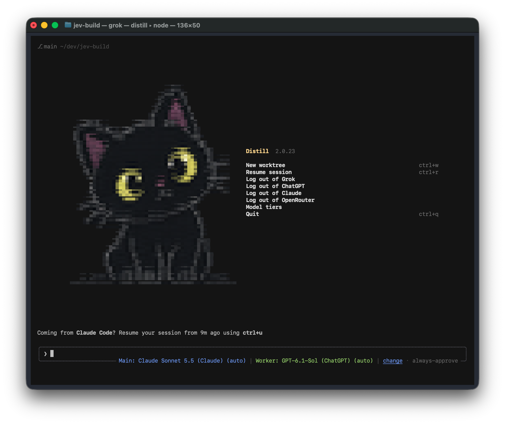
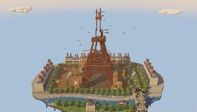
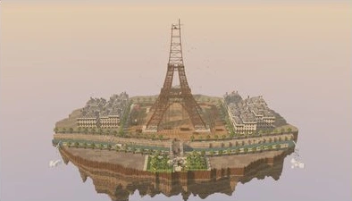
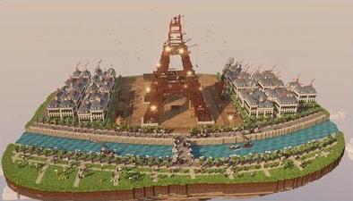
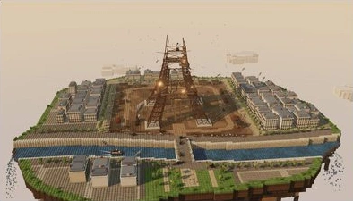
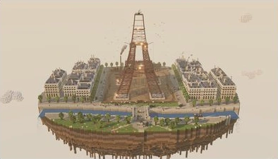

<!-- Modified for Distill by Samuel Fajreldines, 2026. -->
# Distill



Distill is a lightweight coding agent harness and TUI, built to **get far more done
with far fewer tokens.**

It works with Grok, Claude and Codex subscriptions, and with any model that speaks the
OpenAI-compatible protocol.

**Steps:**

1. Download distill.
2. Login with openrouter.
3. Login with your subscription.
4. Save money.

----

## One prompt, five modes

### Paris, 1888

The same prompt in each mode, with Claude Opus 5.5 as the main model and
Claude Sonnet 5.5 as the worker: a 14-second deterministic voxel animation.

<details>
<summary>Prompt</summary>

```text
Build a single self-contained three.js HTML page that renders a 14-second animation (1280x720, 30fps, deterministic: expose window.renderAt(t) so every frame can be captured).

Scene: a floating voxel diorama island - Paris, 1888, the Eiffel Tower under construction. Everything is already moving on frame 1.

Island:
- floating chunk with layered rock underside, the Seine curving across the front with stone quays and an arched bridge
- Champ de Mars: dirt work yard, stacks of iron girders, wooden sheds, a steam engine with a smoking chimney
- around it: rows of Haussmann buildings with cream walls, grey zinc roofs, chimneys, tiny trees along the boulevards

The tower (the hero):
- dark reddish-brown wrought iron lattice made of thin voxel beams with real X-bracing, not solid blocks
- four curved legs and the first platform finished, the second level half built, the top section only a skeleton
- wooden scaffolding towers under the legs, small creeper cranes on the structure lifting girders on chains
- glowing orange rivet sparks where workers hammer, small puffs of steam

Life (hundreds of tiny voxel people, ~3 voxels tall):
- riveting teams on every level with hammers swinging, workers walking along beams
- girders hoisted by cranes swinging slowly into place
- horse-drawn carts carrying iron across the yard, crowds of onlookers in 1880s clothes with top hats and parasols
- a riverboat with a smoking funnel moving along the Seine, carriages crossing the bridge, pigeons circling the tower

Camera and look:
- wide view of the whole island, slow orbit (~25 degrees) with a gentle push-in toward the tower
- warm late-afternoon sun, soft shadows, ambient occlusion, light haze, rounded voxels, ACES tone mapping, soft bloom on sparks
```

</details>

| Mode | Result | Cost | Time |
| --- | --- | ---: | ---: |
| **UltraSave** | <a href="docs/images/eiffel/ultrasave-final.webp"></a> | $2.37 | 25 min |
| **UltraFast** | <a href="docs/images/eiffel/ultrafast-final.webp"></a> | $2.14 | 13 min |
| **UltraCode** | <a href="docs/images/eiffel/ultracode-final.webp"></a> | $7.83 | 45 min |
| **Auto** | <a href="docs/images/eiffel/auto-final.webp"></a> | $4.41 | 27 min |
| **Normal** | <a href="docs/images/eiffel/normal-final.webp"></a> | $3.73 | 26 min |

Cost and time are averages across the final runs. Costs use Anthropic API list
prices. Each image shows one final run at 7 seconds.

## Benchmarks

[](BENCHMARKS.md)

The image shows the 2026-10-16 campaign on Distill 2.0.46. See
[BENCHMARKS.md](BENCHMARKS.md) for the current tables, including one row per
execution mode, with definitions, methodology, cost bounds, reproduction
commands, and source JSON.

## Install

### Mac / Linux

```sh
curl -fsSL https://raw.githubusercontent.com/samuelfaj/distill/main/install.sh | sh  
```

The installer adds `~/.local/share/distill/bin` to your PATH by writing to your shell's rc file (`~/.zshrc`, `~/.bashrc` or `~/.bash_profile`, `~/.config/fish/config.fish`, or `~/.profile`), so open a new terminal afterwards. Set `DISTILL_NO_MODIFY_PATH=1` to skip this and add the directory yourself. In the new terminal, run `distill --version` to check.

### Windows

```sh
irm https://raw.githubusercontent.com/samuelfaj/distill/main/install.ps1 | iex        
$bin = "$env:LOCALAPPDATA\distill\bin"; [Environment]::SetEnvironmentVariable('Path', "$bin;" + [Environment]::GetEnvironmentVariable('Path', 'User'), 'User') 
distill --version
```

## Upgrade

For an installation made with the release installer:

```sh
distill update
```

## Choose your models

Open **Model tiers** on the home screen, click **change** beside the current
model, or enter `/tiers`. You can edit each tier in that screen.

| Tier | Purpose | Picker |
|---|---|---|
| Main model | Required. Owns every session: it plans, specifies, delegates, and reviews the work. | `/model` or `/tiers main` |
| Worker model | Optional. Runs every delegated assignment the main model hands it as a precise spec. Without it, the main model does all the work. | `/worker-model` or `/tiers worker` |
| Utility model | Handles bounded tasks such as extraction, summaries, and compression. | `/utility-model` or `/tiers utility` |

Pick your strongest model as the main model and a cheaper one as the worker:
the main model gives the worker as much of the work as it can do well. Each
tier takes an effort level or `auto`, which lets Jev pick the effort for every
call; `auto` is the default. In the Model tiers screen, enter a tier as
`model effort` (for example `gpt-6-luna auto`). You can supply each selection
directly:

```text
/model gpt-6-sol auto
/worker-model gpt-6-luna auto
/utility-model openrouter-qwen37 auto
```

## Always-on behavior

Two rule sets are built into every system prompt, for the main model and for
its subagents, and neither has an off switch:

- **Caveman**: the agent writes terse prose and keeps code, paths and error
  strings exact. `/caveman lite|full|ultra` changes how hard it compresses
  (default `full`); a stored `off` is ignored.
- **Ponytail**: the agent works like a lazy senior developer. Before writing
  code it asks whether the code needs to exist, then reuses what the codebase
  has, then the standard library, then an installed dependency, and only then
  writes the minimum that works. Validation, error handling, security and
  anything you asked for are never cut. Adapted from
  [ponytail](https://github.com/DietrichGebert/ponytail) (MIT).

### Read More:

- [Accounts and local models](docs/local-models.md)
- [Code Mode (experimental): the model scripts several tool calls in one step](crates/codegen/distill-pager/docs/user-guide/29-code-mode.md)
- [How Jev routes work](docs/jev-routing.md)
- [UltraCode activation, hierarchy limits and paired comparisons](docs/ultracode.md)
- [UltraFast execution mode and paired speed/quality evaluation](docs/ultrafast.md)
- [UltraSave execution mode and paired token/quality evaluation](docs/ultrasave.md)
- [Where the token savings come from](docs/token-saver.md)
