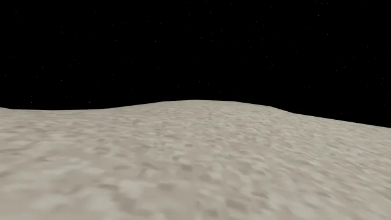
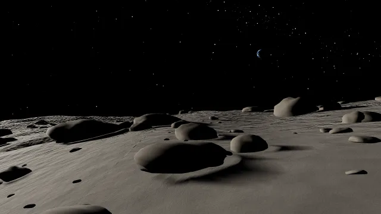
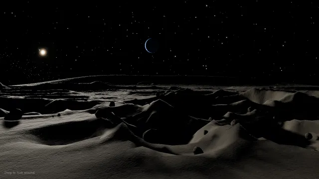
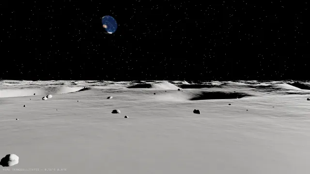
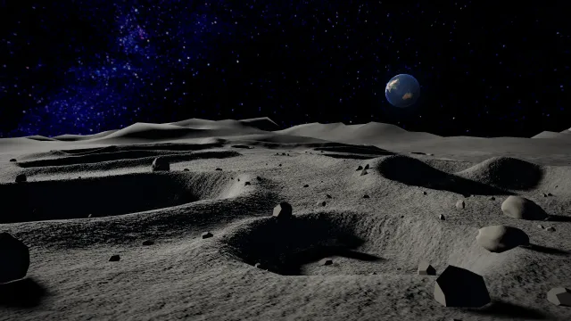
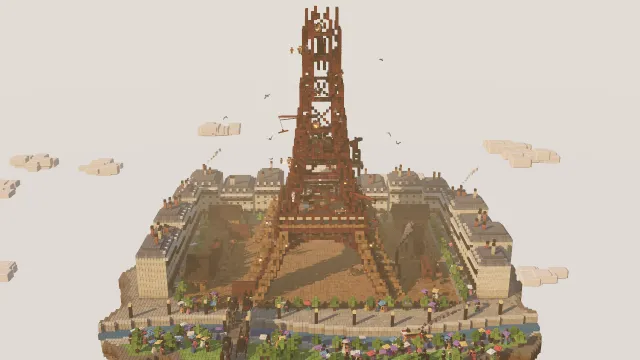
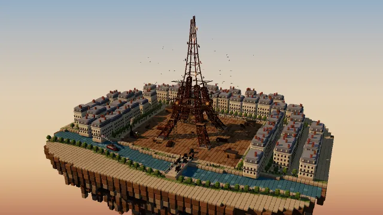
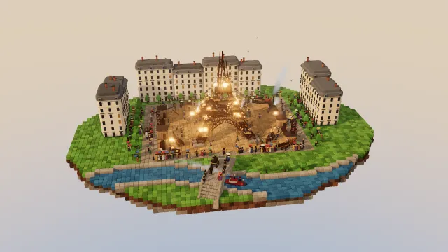
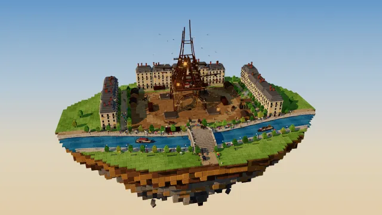
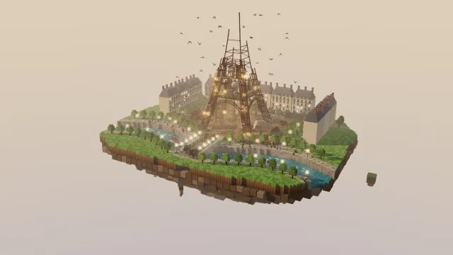

<!-- Modified for Distill by Samuel Fajreldines, 2026. -->
# Distill


Distill is a lightweight coding agent harness and TUI, built to **get far more done
with far fewer tokens.**

It works with Grok, Claude and Codex subscriptions, and with any model that speaks the
OpenAI-compatible protocol.

**Steps:**

1. Download distill.
2. Login with openrouter.
3. Login with your subscription.
4. Save money.

----

## One prompt, five modes

The same prompt in each mode, with Claude Opus 5.5 as the main model and
DeepSeek V4.1 Flash Ultrafast as the worker:

> Create a view of moon surface and the sky, photorealistic. in three.js

Open any scene from the table to run it in your browser, or find all five on
the [Distill page](https://www.samuelfaj.com/en/distill/#benchmarks).

| Mode | Result | Cost | Time | Tokens | Model calls |
| --- | --- | ---: | ---: | ---: | --- |
| [**UltraSave**](https://www.samuelfaj.com/files/distill/moon/ultrasave/) | <a href="https://www.samuelfaj.com/files/distill/moon/ultrasave/"></a> | **$0.058** (0.40x) | 16 min 18 s (3.57x) | 6.2M | 86 DeepSeek |
| [**UltraFast**](https://www.samuelfaj.com/files/distill/moon/ultrafast/) | <a href="https://www.samuelfaj.com/files/distill/moon/ultrafast/"></a> | $0.577 (4.00x) | 8 min 7 s (1.77x) | 0.5M | 18 Opus |
| [**UltraCode**](https://www.samuelfaj.com/files/distill/moon/ultracode/) | <a href="https://www.samuelfaj.com/files/distill/moon/ultracode/"></a> | $1.011 (7.00x) | 15 min 29 s (3.39x) | 7.8M | 19 Opus, 73 DeepSeek |
| [**Auto**](https://www.samuelfaj.com/files/distill/moon/auto/) | <a href="https://www.samuelfaj.com/files/distill/moon/auto/"></a> | $0.508 (3.52x) | 15 min 29 s (3.39x) | 6.0M | 8 Opus, 77 DeepSeek |
| [**Normal**](https://www.samuelfaj.com/files/distill/moon/normal/) | <a href="https://www.samuelfaj.com/files/distill/moon/normal/"></a> | $0.145 (1.00x) | **4 min 34 s** (1.00x) | 1.9M | 5 Opus, 32 DeepSeek |

Ratios are against Normal. One run per mode, all five started at the same time
on 2026-11-12 with distill 2.0.9 (9bbf0aafec73), the commit of v2.0.72; each
finished with exit code 0. A single run per mode carries run-to-run variation:
here Normal handed the build to the worker once and accepted the first result,
so it finished first, while UltraFast kept all 18 rounds on Opus. UltraSave led
on the worker, and UltraCode ended with `Verification: REVIEWED`. Cost is an
estimate: Opus at list API prices ($4/M input, $0.20/M cached, $5/M cache
write, $20/M output; the runs used a Claude subscription) and DeepSeek at
OpenGateway's billed prices ($0.09/M input, $0.36/M output, $0.0018/M cached),
without the Jev routing calls, which have no published price. Thumbnails are
frames captured in headless Chrome at 1280×720.

### Paris, 1888

A harder prompt, with Claude Opus 5.5 as the main model and Claude Sonnet 5.5
as the worker: a 14-second deterministic voxel animation. Each scene plays on
its own when you open it.

<details>
<summary>Prompt</summary>

```text
Build a single self-contained three.js HTML page that renders a 14-second animation (1280x720, 30fps, deterministic: expose window.renderAt(t) so every frame can be captured).

Scene: a floating voxel diorama island - Paris, 1888, the Eiffel Tower under construction. Everything is already moving on frame 1.

Island:
- floating chunk with layered rock underside, the Seine curving across the front with stone quays and an arched bridge
- Champ de Mars: dirt work yard, stacks of iron girders, wooden sheds, a steam engine with a smoking chimney
- around it: rows of Haussmann buildings with cream walls, grey zinc roofs, chimneys, tiny trees along the boulevards

The tower (the hero):
- dark reddish-brown wrought iron lattice made of thin voxel beams with real X-bracing, not solid blocks
- four curved legs and the first platform finished, the second level half built, the top section only a skeleton
- wooden scaffolding towers under the legs, small creeper cranes on the structure lifting girders on chains
- glowing orange rivet sparks where workers hammer, small puffs of steam

Life (hundreds of tiny voxel people, ~3 voxels tall):
- riveting teams on every level with hammers swinging, workers walking along beams
- girders hoisted by cranes swinging slowly into place
- horse-drawn carts carrying iron across the yard, crowds of onlookers in 1880s clothes with top hats and parasols
- a riverboat with a smoking funnel moving along the Seine, carriages crossing the bridge, pigeons circling the tower

Camera and look:
- wide view of the whole island, slow orbit (~25 degrees) with a gentle push-in toward the tower
- warm late-afternoon sun, soft shadows, ambient occlusion, light haze, rounded voxels, ACES tone mapping, soft bloom on sparks
```

</details>

| Mode | Result | Cost | Time | Tokens | Model calls |
| --- | --- | ---: | ---: | ---: | --- |
| [**UltraSave**](https://www.samuelfaj.com/files/distill/eiffel/ultrasave/) | <a href="https://www.samuelfaj.com/files/distill/eiffel/ultrasave/"></a> | **$3.66** (0.69x) | 45 min 15 s (0.75x) | 2.5M | 35 Sonnet |
| [**UltraFast**](https://www.samuelfaj.com/files/distill/eiffel/ultrafast/) | <a href="https://www.samuelfaj.com/files/distill/eiffel/ultrafast/"></a> | **$1.29** (0.24x) | **10 min 0 s** (0.17x) | 0.5M | 11 Opus |
| [**UltraCode**](https://www.samuelfaj.com/files/distill/eiffel/ultracode/) | <a href="https://www.samuelfaj.com/files/distill/eiffel/ultracode/"></a> | $10.94 (2.07x) | 2 h 23 min 59 s (2.38x) | 4.0M | 32 Opus, 43 Sonnet |
| [**Auto**](https://www.samuelfaj.com/files/distill/eiffel/auto/) | <a href="https://www.samuelfaj.com/files/distill/eiffel/auto/"></a> | $9.13 (1.73x) | 1 h 32 min 37 s (1.53x) | 7.5M | 23 Opus, 74 Sonnet |
| [**Normal**](https://www.samuelfaj.com/files/distill/eiffel/normal/) | <a href="https://www.samuelfaj.com/files/distill/eiffel/normal/"></a> | $5.29 (1.00x) | 1 h 0 min 26 s (1.00x) | 2.8M | 9 Opus, 31 Sonnet |

Ratios are against Normal. One run per mode, all five started at the same time
on 2026-11-13 with distill 2.0.9 (9bbf0aafec73), the commit of v2.0.72; each
finished with exit code 0, and UltraCode ended with `Verification: REVIEWED`.
Here the worker cost more than the main model working alone: Sonnet wrote
290,000 to 830,000 output tokens per run, most of it reasoning before each
command, and rounds of up to 16 minutes, while Opus alone in UltraFast wrote
44,000 and finished first. Cost is an estimate at Anthropic's list API prices
(Opus $4/M input, $0.20/M cached, $5/M cache write, $20/M output; Sonnet $2,
$0.10, $2.50 and $10; the runs used a Claude subscription), without the Jev
routing calls. Thumbnails are the frame at 7 s, from `window.renderAt(7)`.

## Benchmarks

[](BENCHMARKS.md)

The image shows the 2026-10-16 campaign on Distill 2.0.46. See
[BENCHMARKS.md](BENCHMARKS.md) for the current tables, including one row per
execution mode, with definitions, methodology, cost bounds, reproduction
commands, and source JSON.

## Install

### Mac / Linux

```sh
curl -fsSL https://raw.githubusercontent.com/samuelfaj/distill/main/install.sh | sh  
```

The installer adds `~/.local/share/distill/bin` to your PATH by writing to your shell's rc file (`~/.zshrc`, `~/.bashrc` or `~/.bash_profile`, `~/.config/fish/config.fish`, or `~/.profile`), so open a new terminal afterwards. Set `DISTILL_NO_MODIFY_PATH=1` to skip this and add the directory yourself. In the new terminal, run `distill --version` to check.

### Windows

```sh
irm https://raw.githubusercontent.com/samuelfaj/distill/main/install.ps1 | iex        
$bin = "$env:LOCALAPPDATA\distill\bin"; [Environment]::SetEnvironmentVariable('Path', "$bin;" + [Environment]::GetEnvironmentVariable('Path', 'User'), 'User') 
distill --version
```

## Upgrade

For an installation made with the release installer:

```sh
distill update
```

## Choose your models

Open **Model tiers** on the home screen, click **change** beside the current
model, or enter `/tiers`. You can edit each tier in that screen.

| Tier | Purpose | Picker |
|---|---|---|
| Main model | Required. Owns every session: it plans, specifies, delegates, and reviews the work. | `/model` or `/tiers main` |
| Worker model | Optional. Runs every delegated assignment the main model hands it as a precise spec. Without it, the main model does all the work. | `/worker-model` or `/tiers worker` |
| Utility model | Handles bounded tasks such as extraction, summaries, and compression. | `/utility-model` or `/tiers utility` |

Pick your strongest model as the main model and a cheaper one as the worker:
the main model gives the worker as much of the work as it can do well. Each
tier takes an effort level or `auto`, which lets Jev pick the effort for every
call; `auto` is the default. In the Model tiers screen, enter a tier as
`model effort` (for example `gpt-6-luna auto`). You can supply each selection
directly:

```text
/model gpt-6-sol auto
/worker-model gpt-6-luna auto
/utility-model openrouter-qwen37 auto
```

## Always-on behavior

Two rule sets are built into every system prompt, for the main model and for
its subagents, and neither has an off switch:

- **Caveman**: the agent writes terse prose and keeps code, paths and error
  strings exact. `/caveman lite|full|ultra` changes how hard it compresses
  (default `full`); a stored `off` is ignored.
- **Ponytail**: the agent works like a lazy senior developer. Before writing
  code it asks whether the code needs to exist, then reuses what the codebase
  has, then the standard library, then an installed dependency, and only then
  writes the minimum that works. Validation, error handling, security and
  anything you asked for are never cut. Adapted from
  [ponytail](https://github.com/DietrichGebert/ponytail) (MIT).

### Read More:

- [Accounts and local models](docs/local-models.md)
- [How Jev routes work](docs/jev-routing.md)
- [UltraCode activation, hierarchy limits and paired comparisons](docs/ultracode.md)
- [UltraFast execution mode and paired speed/quality evaluation](docs/ultrafast.md)
- [UltraSave execution mode and paired token/quality evaluation](docs/ultrasave.md)
- [Where the token savings come from](docs/token-saver.md)
