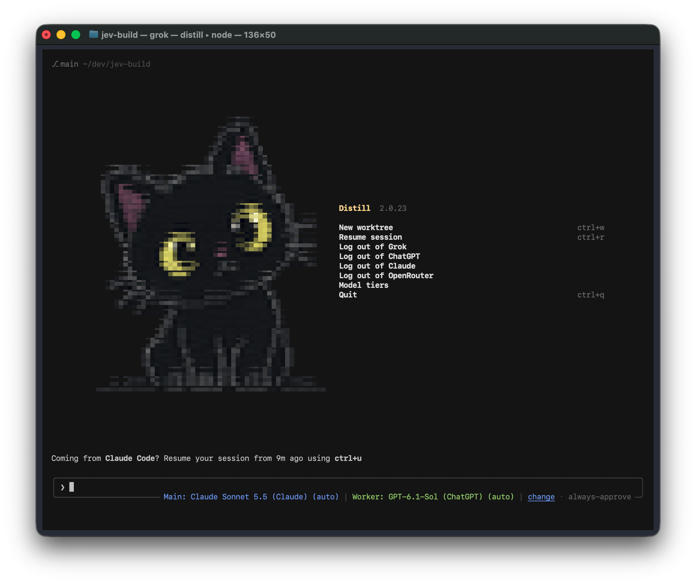

<!-- Modified for Distill by Samuel Fajreldines, 2026. -->
# Distill



Distill is a lightweight coding agent harness and TUI, built to **get far more done
with far fewer tokens.**

It works with Grok, Claude and Codex subscriptions, and with any model that speaks the
OpenAI-compatible protocol.

**Steps:**

1. Download distill.
2. Login with openrouter.
3. Login with your subscription.
4. Save money.

----

## Modes

Each session runs in one execution mode. Auto is the default. Switch with a
slash command in the TUI, or pass a flag to headless prompts.

<table>
<tr>
<td width="25%" valign="top">

### UltraSave

<!-- benchmarks:ultrasave:begin -->
<!-- benchmarks:ultrasave:end -->
# 93% cheaper

UltraSave cost **0.069x the credits of Normal** on our 20-case benchmark,
and all 20 tasks still passed.

It works directly: narrow searches, small reads, short reports. Required checks
still run before a task counts as done.

`/ultrasave on` or `--ultrasave`

</td>
<td width="25%" valign="top">

### UltraFast

<!-- benchmarks:ultrafast:begin -->
<!-- benchmarks:ultrafast:end -->
# ~2x faster

UltraFast finished in **0.509x the wall time of Normal**, about half,
and all 20 tasks still passed.

It skips planning and delegation rounds and goes straight to the work. Your
model, effort and verification steps stay the same.

`/ultrafast on` or `--ultrafast`

</td>
<td width="25%" valign="top">

### UltraCode

<!-- benchmarks:ultracode:begin -->
<!-- benchmarks:ultracode:end -->
# Extra care

UltraCode means extra care: higher effort and verification discipline. With
automatic effort it leans one level higher than Normal, and it asks for the
root cause before an edit and a check of the changed behavior after it.

Delegation is optional and has no speed or cost claim yet. Your model and
permissions stay the same.

`/ultracode on` or `--ultracode`

</td>
<td width="25%" valign="top">

### Auto

<!-- benchmarks:auto:begin -->
<!-- benchmarks:auto:end -->
# Balanced

Auto used **57% less total time** and **77% fewer estimated LLM credits**
than Normal; both passed **20/20 tasks** in our paired benchmark.

It switches modes as work changes. Subagents inherit Auto and adapt independently.

`/mode auto` or `--mode auto`

[Results and tradeoffs](https://github.com/samuelfaj/distill/pull/45).

</td>
</tr>
</table>

Details:
[UltraSave](docs/ultrasave.md), [UltraFast](docs/ultrafast.md) and
[UltraCode](docs/ultracode.md).

## Benchmarks

[](BENCHMARKS.md)

See [BENCHMARKS.md](BENCHMARKS.md) for the full results tables, definitions,
methodology, cost bounds, reproduction commands, and source JSON.

## Install

### Mac / Linux

```sh
curl -fsSL https://raw.githubusercontent.com/samuelfaj/distill/main/install.sh | sh  
```

The installer adds `~/.local/share/distill/bin` to your PATH by writing to your shell's rc file (`~/.zshrc`, `~/.bashrc` or `~/.bash_profile`, `~/.config/fish/config.fish`, or `~/.profile`), so open a new terminal afterwards. Set `DISTILL_NO_MODIFY_PATH=1` to skip this and add the directory yourself. In the new terminal, run `distill --version` to check.

### Windows

```sh
irm https://raw.githubusercontent.com/samuelfaj/distill/main/install.ps1 | iex        
$bin = "$env:LOCALAPPDATA\distill\bin"; [Environment]::SetEnvironmentVariable('Path', "$bin;" + [Environment]::GetEnvironmentVariable('Path', 'User'), 'User') 
distill --version
```

## Upgrade

For an installation made with the release installer:

```sh
distill update
```

## Choose your models

Open **Model tiers** on the home screen, click **change** beside the current
model, or enter `/tiers`. You can edit each tier in that screen.

| Tier | Purpose | Picker |
|---|---|---|
| Main model | Required. Owns every session: it plans, specifies, delegates, and reviews the work. | `/model` or `/tiers main` |
| Worker model | Optional. Runs every delegated assignment the main model hands it as a precise spec. Without it, the main model does all the work. | `/worker-model` or `/tiers worker` |
| Utility model | Handles bounded tasks such as extraction, summaries, and compression. | `/utility-model` or `/tiers utility` |

Pick your strongest model as the main model and a cheaper one as the worker:
the main model gives the worker as much of the work as it can do well. Each
tier takes an effort level or `auto`, which lets Jev pick the effort for every
call; `auto` is the default. In the Model tiers screen, enter a tier as
`model effort` (for example `gpt-6-luna auto`). You can supply each selection
directly:

```text
/model gpt-6-sol auto
/worker-model gpt-6-luna auto
/utility-model openrouter-qwen37 auto
```

## Always-on behavior

Two rule sets are built into every system prompt, for the main model and for
its subagents, and neither has an off switch:

- **Caveman**: the agent writes terse prose and keeps code, paths and error
  strings exact. `/caveman lite|full|ultra` changes how hard it compresses
  (default `full`); a stored `off` is ignored.
- **Ponytail**: the agent works like a lazy senior developer. Before writing
  code it asks whether the code needs to exist, then reuses what the codebase
  has, then the standard library, then an installed dependency, and only then
  writes the minimum that works. Validation, error handling, security and
  anything you asked for are never cut. Adapted from
  [ponytail](https://github.com/DietrichGebert/ponytail) (MIT).

### Read More:

- [Accounts and local models](docs/local-models.md)
- [How Jev routes work](docs/jev-routing.md)
- [UltraCode activation, hierarchy limits and paired comparisons](docs/ultracode.md)
- [UltraFast execution mode and paired speed/quality evaluation](docs/ultrafast.md)
- [UltraSave execution mode and paired token/quality evaluation](docs/ultrasave.md)
- [Where the token savings come from](docs/token-saver.md)
